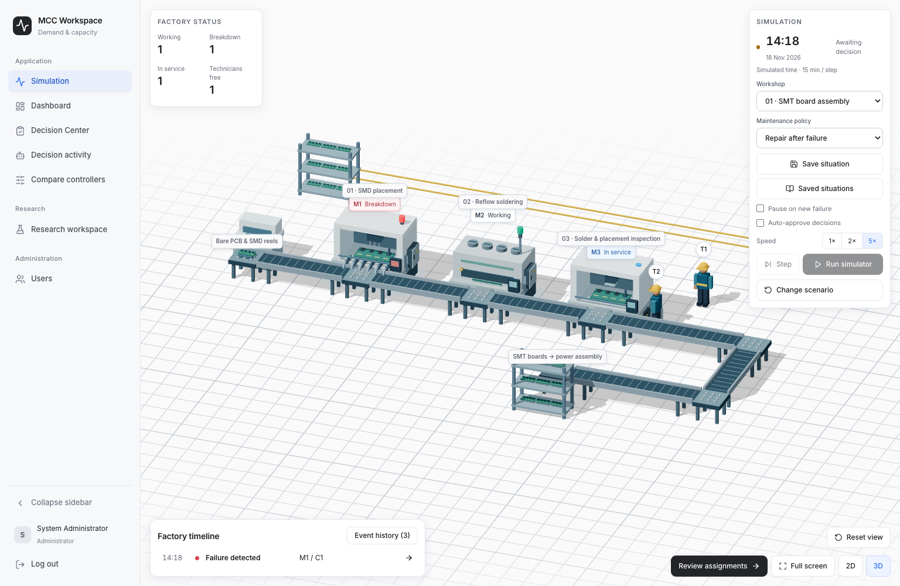
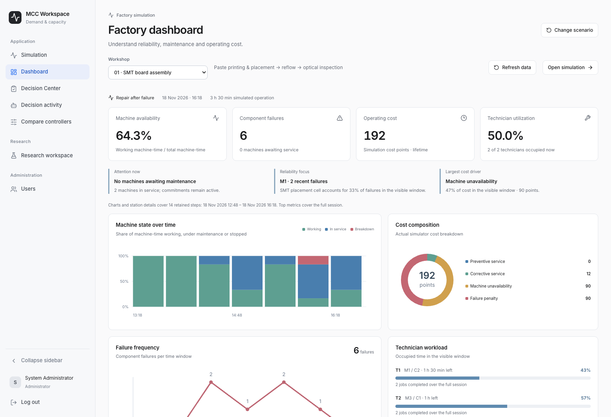
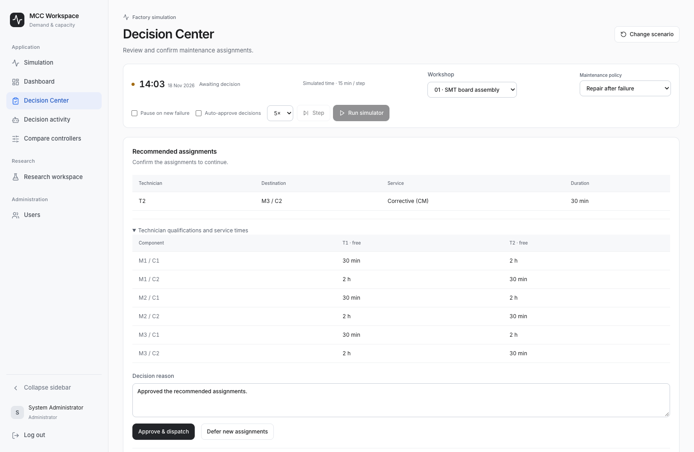
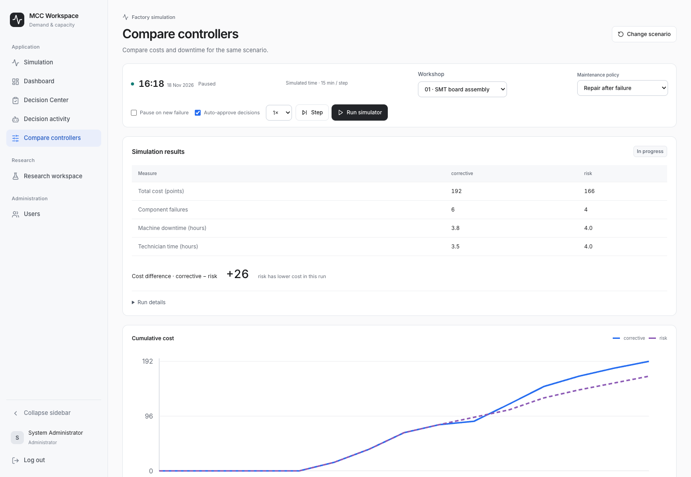
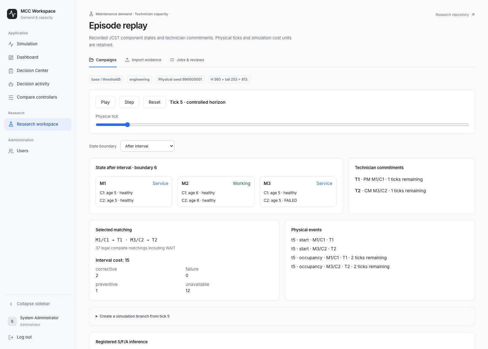

# Maintenance Coordination Workspace

Maintenance Coordination Workspace is a browser-based factory simulator and research platform for deciding **which machine to service, when, and with which technician**. Run a simulated server power supply workshop, review a repair assignment when a component fails, and compare what different maintenance policies would have done under the same conditions.

[Run locally](#run-locally) · [Product tour](#product-tour) · [Architecture](#architecture) · [Research documentation](docs/research/runbook.md)



*The SMT workshop during a local simulation, with machine states, technician assignments, and the incident timeline visible.*

## Product tour

### Monitor the factory

Explore four workshops in a server power supply production flow, from SMT assembly to reliability testing and pack-out. The dashboard shows availability, failure frequency, technician workload, and cost for the selected workshop. Open a station from the dashboard to inspect it on the factory floor. Save a workshop situation to reopen it later as an independent simulation, or inject a component failure to test a specific maintenance handoff.



### Review a dispatch decision

Pause for operator review to see which technician the policy recommends, where to send them, and how long the job is expected to take. Review technician qualifications, then approve the proposal, defer new work, or choose another eligible assignment. The session keeps the decision and your reason.



### Compare maintenance policies

Choose a maintenance policy and a baseline when you set up a scenario. Both run under the same physical seed. Compare costs, downtime, failures, and technician time as the simulation advances. The rule-based options include corrective, risk-based, and age-threshold maintenance. Structured, ablated, and flat PPO policies are available when their checkpoints are installed and registered.



### Replay research evidence

Import a JCST evidence bundle to browse campaign results and step through recorded episodes. The replay shows component states, technician commitments, the selected assignment, and costs at each interval. Start a separate what-if branch from a recorded state to evaluate another action while preserving the original episode. See the [companion research repository](https://github.com/AIVIETNAM-AIO-BachNguyen/maintenance-capacity-coordination) for the experiment protocol and training code.



*Screenshots were captured in Chromium from a local run of the frontend, Express API, PostgreSQL, and JCST simulator. The controller results illustrate one engineering scenario. The workshops model maintenance behavior with illustrative equipment layouts and time scales.*

## Run locally

**Prerequisites** · Node.js 22, npm, Python 3.12.10 or newer in the 3.12 series, [uv](https://docs.astral.sh/uv/), and Docker Compose for PostgreSQL 16. An existing local PostgreSQL 16 instance also works. See [local development](DEV-LOCAL.md).

For a fresh checkout, run these commands from the repository root.

```bash
cp .env.example .env
cp backend/.env.example backend/.env
cp frontend/.env.local.example frontend/.env.local

docker compose up -d --wait postgre_db
npm ci --prefix backend
npm ci --prefix frontend
uv sync --frozen --project ai_services
```

For an existing checkout, keep your environment files and confirm that `DATABASE_URL` points to your local database. Set your local sign-in password with `ADMIN_PASSWORD` in `backend/.env`, then apply the migrations and seed the administrator.

```bash
(cd backend && npm run prisma:generate && npx prisma migrate deploy && npm run prisma:seed)
```

Start the web stack from the repository root.

```bash
bash scripts/dev-web.sh
```

Open [http://localhost:3000](http://localhost:3000) and sign in as `admin` with the configured password. The script starts Next.js, the API on port `5000`, and the research worker.

1. In **Simulation**, select **Repair after failure**, choose **Risk-based maintenance** as the comparison policy, and set **Maintenance decisions begin** to **After the first failure**. Click **Start simulation**. Use **5×** to speed up playback.
2. Turn off **Auto-approve decisions** to review the next proposal yourself. Open **Review assignments**, then approve the dispatch or choose an alternative. Visit **Dashboard** for workshop metrics and **Compare controllers** for the two policy runs.
3. In **Research workspace → Import evidence**, upload the [sample JCST bundle](contracts/jcst/v1/fixtures/engineering-bundle.json). Follow the validation job, open the imported campaign, and select an episode to replay.

The rule-based demo runs without learned checkpoints. For PPO inference, configure `JCST_PYTHON` and `JCST_RELEASE_REGISTRY` as described in the [research runbook](docs/research/runbook.md).

## Architecture

| Component | Responsibility |
| --- | --- |
| [Frontend](frontend/) | Next.js, React, and Three.js power the 3D simulator, factory dashboard, policy comparison, and research workspace. |
| [Backend](backend/) | Express and Prisma handle authentication, simulation commands, persisted sessions and audit records, and the research job queue. |
| [JCST simulator](ai_services/domain/jcst/) | Python models component failures, technician eligibility, maintenance duration, and costs. The Express API invokes it through a local Python bridge. |
| [Research worker](backend/src/research/worker.js) | Processes evidence imports, replay checks, and copied-state research jobs. PostgreSQL stores job state and metadata, and the artifact store holds evidence files. |

[Live demo guide](docs/research/live-demo.md) · [System architecture](docs/research/architecture.md) · [Research API specification](backend/research-openapi.yaml) · [JCST contract](contracts/jcst/v1/README.md)
