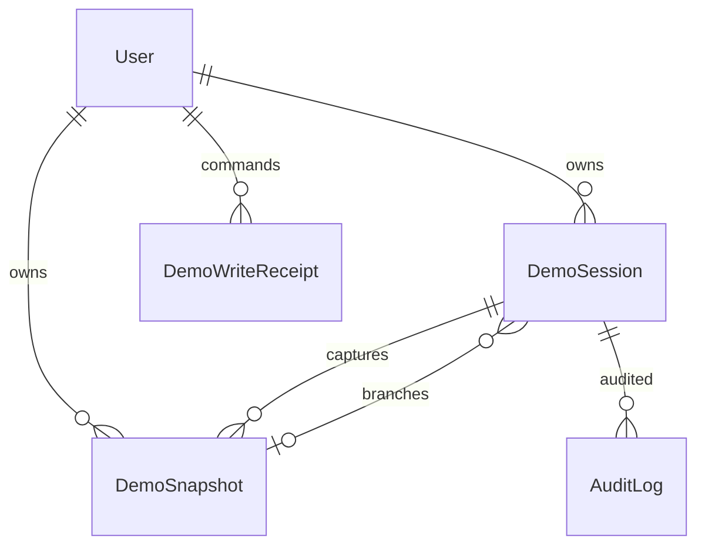

# Saved simulation situations and controlled incidents — M0/M1

Base: `30a27f820e511567f7fad8199f123f75646cd9f3` (main, fetched 2026-11-16).
Backend branch: `feat/jcst-snapshots-incidents`. No frontend or vendor physics changes.

## Contract ownership and dependency

This is the backend proposal for M0; it is not a claim of joint Flex acceptance.
Use the full existing runtime JSON payload, wrapped as `jcst-demo-snapshot/1`.
Store both lanes, config, pinned source/checkpoint hashes, physical seed, counters,
retained records, pending REVIEW proposal, continuous/COMPLETE status, simulation
start/step seconds, context and incident queue. Never reconstruct from a source
session or from traces. The snapshot has no mutable update/delete API.

Flex must provide these bridge operations, with `protocol: 'jcst-situations/1'`:

* `demo_snapshot_restore`: input `snapshot` (the complete frozen wrapper); output
  `{protocol, session}`. Validate pinned engine, config and every checkpoint before
  returning the unchanged physical state/counters/proposal/queue. No policy step.
* `demo_incident`: input `session`, `event`; output `{protocol, session, event}`.
  The event is server-created. Immediate application retains tick. Future events
  remain SCHEDULED. Primary lane only. Reject REVIEW immediate writes. A machine
  with any failed component or active repair skips with COMPONENT_ALREADY_FAILED
  or MACHINE_IN_SERVICE. `reason` is the outcome reason; `requestedReason` is the
  operator's explanation. APPLIED/SKIPPED have appliedTick equal scheduledTick.
* `demo_situation_command`: input `session`, `command`, `actor`; output
  `{protocol, session}`. Execute advance/autoplay/approve/override/configure using
  the existing command fields. Apply due incidents before observation/assignment
  at every boundary, including internal autoplay ticks. A scheduled incident at
  a REVIEW boundary applies only after the pending decision is resolved; reject
  if that would silently alter an already approved matching. Return a clear
  conflict, never silently postpone an incident. COMPLETE stays COMPLETE until
  configure. Preserve event IDs and terminal outcomes across all retries.

Missing protocol support returns 503 DEMO_SCENARIO_RUNTIME_UNAVAILABLE. Structured
bridge errors can specify DEMO_RELEASE_UNAVAILABLE (409),
DEMO_SNAPSHOT_INCOMPATIBLE (409), or DEMO_INTERVENTION_REPLAY_UNSUPPORTED (409).
No Node fallback fabricates a failure or calls an arbitrary external URL.
The current integrated bridge has none of these operations. M2 remains pending.

## API and concurrency

See `jcst-situations.openapi.yaml`, `contracts/jcst-situations.d.ts` and
`jcst-situations-examples.json`. Mounted under `/api/v1/research/demo` and also
referenced from the main research OpenAPI. Success uses `{success:true,data}`;
errors use the existing research API envelope. Every response is no-store.

All writes require ADMIN/ENGINEER, a valid Idempotency-Key and integer revision.
Snapshot open supplies the immutable sourceRevision, not a live source revision.
Reads: active ADMIN sees all, others see only owned snapshots/sessions. A snapshot
saved by an ADMIN belongs to that ADMIN; the source owner is recorded separately
in provenance. Lists sort createdAt DESC, id DESC with bounded limit (1..100,
default 20); opaque cursor binds actor/role and order. Unknown/repeated query
parameters fail validation. Detail never exposes the raw frozen payload.

Receipts are unique per actor/key across snapshot/save/open/incident and new
session commands; hash includes operation/target/body. Retry returns the exact
stored response even after later commands. Same key/different body is 409.
Authorization is checked before receipt replay. Legacy last-command replay is
retained only for pre-migration sessions/commands without a new receipt.

Lock order: user FOR SHARE (fresh active/global role) → actor/key advisory lock →
target session FOR UPDATE. Snapshot opening locks only the immutable snapshot
after the actor/key lock. Runtime work runs outside write transactions; final
transaction repeats authorization and revision checks. Membership/factory access
does not apply to research owner-scoped sessions. Each mutation, audit and receipt
commits together. Save holds the source session lock while copying the payload;
save does not advance tick or increment revision.

Branch provenance: source snapshot/hash/session/revision/tick plus branch tick,
branch ID and intervention revision. Frozen counters are retained, not reset.
Comparisons must subtract branch baselines and compare policies from the same
post-intervention state. This base has no live-comparison.js or HTTP live compare
API; intervention-bearing finite scientific replay is explicitly unsupported.
Never export an intervention session as an unmodified scientific Episode.

## Data model



Snapshot payload+hash are immutable; FK Restrict protects provenance. Receipt
response is immutable. No existing migration is edited. No canonical hashes or
old runtime JSON are backfilled/recomputed. New indexes support owner/keyset reads.

Health events keep the existing natural-event je1_ identity unchanged. Controlled
failure events are a separate OpenAPI union member: incident UUID,
provenance=CONTROLLED_INCIDENT, recordTick=boundary tick and eventIndex=-1 (no
transition ordinal). Work orders reference the same incident UUID. An intervention
does not invent a transition, change its tick, or rewrite its natural events.

## Local invocation and deployment

1. Back up DB; deploy the additive migration with `npx prisma migrate deploy` and
   regenerate Prisma client. Existing sessions remain valid.
2. Set up the existing Python bridge and pinned runtime. Do not enable consumers
   until the three operations above pass real engine acceptance. Snapshot save,
   list and detail work without those operations; runtime-dependent writes fail
   closed and do not create sessions/events/receipts on runtime failure.
3. Authenticate as ENGINEER/ADMIN. Create a policy session with case=base,
   seed=990000001, primary=corrective, baseline=wait, continuous=true.
4. POST sessions/{id}/snapshots with `{revision:0,name:'Healthy workshop',
   description:'Before intervention',layoutId:'smt-board-assembly'}` and a fresh
   Idempotency-Key. GET snapshots?limit=20, then GET snapshots/{snapshotId}.
5. POST snapshots/{snapshotId}/sessions with `{revision:0}` and another key.
   POST sessions/{newId}/incidents with `{revision:0,machineIndex:2,
   componentIndex:1,scheduledTick:0,reason:'Controlled failure exercise'}`.
6. Scheduled event: use a future tick and new revision/key. Existing command API
   advances the branch through the situation bridge; GET incidents only reads.

Rollback: disable new consumers/routes via code rollback; keep additive tables
and receipts. Do not drop snapshots, source sessions or audit. Old code cannot
safely advance intervention branches: drain/quiesce those sessions first. Never
replay a branch with the pre-situation runtime.

Tests: `npm test -- --runInBand`; focused HTTP/PostgreSQL harness:
`node tests/integration/run-integration-tests.js --demo-situations` with an explicit
TEST_DATABASE_URL pointing to a dedicated test database. Harness creates/drops its
own schema. M1 uses a contract bridge double, not physical engine evidence.
M2 must test real checkpoint validation, immediate and scheduled incidents across
all command paths, independent reopen after trace eviction, and Compare/replay.

Windows local PostgreSQL 18 convenience runner (creates a private cluster, never
uses `.env` DB credentials): `node tests/helpers/run-situations-local.js --regression`.
Set SITUATIONS_PG_BIN to the PostgreSQL bin directory if different. It stops its
own server and drops its own schemas. Failed-run logs are kept in its temp folder.
Health/work-order regressions use the pinned real runtime; situation tests use
the explicitly labelled M1 bridge double. Regenerate/check contract examples:
`node scripts/export-jcst-situations-examples.js [--check]`.

Example curl (authenticated token and actual response IDs must be supplied):

```sh
BASE=http://localhost:5000/api/v1/research/demo
curl "$BASE/sessions/$SESSION_ID/snapshots" \
  -H "Authorization: Bearer $TOKEN" -H 'Content-Type: application/json' \
  -H 'Idempotency-Key: save-situation-001' \
  -d '{"revision":0,"name":"Healthy workshop","layoutId":"smt-board-assembly"}'
curl "$BASE/snapshots?limit=20" -H "Authorization: Bearer $TOKEN"
curl "$BASE/snapshots/$SNAPSHOT_ID/sessions" \
  -H "Authorization: Bearer $TOKEN" -H 'Content-Type: application/json' \
  -H 'Idempotency-Key: open-situation-001' -d '{"revision":0}'
curl "$BASE/sessions/$BRANCH_ID/incidents" \
  -H "Authorization: Bearer $TOKEN" -H 'Content-Type: application/json' \
  -H 'Idempotency-Key: incident-001' \
  -d '{"revision":0,"machineIndex":2,"componentIndex":1,"scheduledTick":0,"reason":"Training failure"}'
```

The last two commands require the Flex bridge. 503 is expected until it is
installed; do not interpret an M1 mock test as a working physical intervention.
