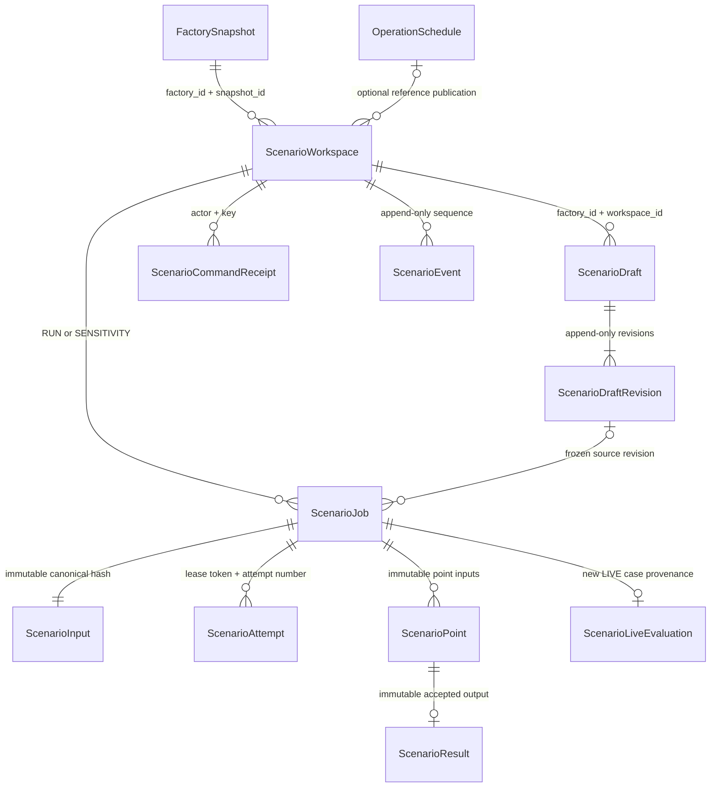

# Scenario Planning — M0 contract proposal

Historical proposal and early Backend checkpoint. Current integrated implementation,
engine versions and executable acceptance commands are documented in
`../../docs/scenario-engine-runbook.md`. The authoritative current wire contract is
`scenario-planning.openapi.json`, including generated `contracts/scenario/v1` models.
Statements below about pending engine work describe the original checkpoint only.
See `scenario-handoff.md` for consumer curl/setup and boundary semantics.

Base: `c926d5d24566834850cf4a16af0792af9c7d50fd` (fetched 2026-10-27).
Branch: `feat/scenario-planning-backend`. Status: M0 in progress, not API_READY or VERIFIED_DONE.
Scope follows the shared 2026-10-27 brief. No dependency on Incident APIs.
Flex engine and Frontend dependency SHAs are pending; this proposal is not a claim of joint approval.

Review artifacts: `scenario-planning.openapi.json`, `scenario-planning.d.ts` and
`scenario-planning-examples.json`. Regenerate/check the proposal with
`node scripts/export-scenario-contract.js [--check]`. The OpenAPI explicitly labels
the two unresolved Flex response schemas; it is not yet added to the served API
or advertised as a frozen consumer contract. Request policy tests run with
`npm test -- --runInBand tests/scenario-policy.test.js`.

Proposed validation bounds needing joint review: maintenance duration 1–43200 minutes,
planning horizon 1–43200 minutes, each weight 0–1000000 and their sum >1e-12 (matching
the canonical nonzero tolerance). Sweeps require explicit 1–7 unique values; clients
default to five rather than relying on unspecified server-generated ranges.

## Persistence and integrity



Every child carries factory/workspace scope and composite foreign keys, not only a globally unique UUID. References use RESTRICT; no hard-delete API. Workspace baseline snapshot/hash, publication identity/hash/plan version and planning/sampling/engine configuration are immutable. Draft changes append a revision and advance the current revision using a compare-and-swap. Enqueue copies the referenced revision into an immutable input in the same transaction as the job, audit event and receipt. Engine-effective snapshot, hash, transformation diff and versions are persisted as immutable output, never registered as an Operations snapshot/head.

Run input includes both a no-overrides baseline evaluation and the scenario evaluation with identical objectives/config/engine/sampling. Reference publication is a separate historical reference, not the computed baseline. A sweep has separately persisted ordered points; unsuccessful points cannot disappear. Retry appends an attempt and uses the original input. Result uniqueness and a live, unexpired lease-token fence prevent late workers from replacing accepted output.

## Authorization and serialization

Active ADMIN/ENGINEER may create/edit/enqueue/handoff. Active OPERATOR/VIEWER may read within factory access. No owner-private ACL. All access uses the existing factory-access service and selected authorization source. Writes take the existing factory advisory lock, then ordered user row locks, then freshly check active/global role/membership before reading any receipt. A revoke that wins the factory lock blocks writes and receipt replay. Worker execution is system work and does not impersonate the creator.

Reads use a consistent transaction and never mutate jobs or Operations state. Missing/inaccessible workspace/run IDs return the same 404. Errors and successes have no-store and correlation headers. Cursors bind actor, factory, workspace and filters; list order is created_at DESC/id DESC with timestamp precision preserved. Default limit 20, maximum 100. Compare accepts 2–4 unique completed run IDs from one workspace.

## Job and engine boundary

Job status: QUEUED/RUNNING/SUCCEEDED/FAILED. Evaluation outcome: FEASIBLE/NO_FEASIBLE_PLAN. Point status: QUEUED/RUNNING/FEASIBLE/NO_FEASIBLE_PLAN/FAILED/TIMEOUT. Sweep outcome: COMPLETE/PARTIAL_FAILED/FAILED. NO_FEASIBLE_PLAN is a completed domain evaluation, not an infrastructure error. COMPLETE means every point evaluated; it does not imply every point feasible.

Proposed bounded policy: 3 supported strategies, 7 unique sweep points, 1000 Monte Carlo draws/point, 30 seconds solver/point and 300 seconds total job deadline. Attempts are bounded; overall deadline never resets on retry. Claim/reclaim and persistence are short transactions; planner calls run outside them. Engine endpoint is server-configured, never accepted from a request. Responses must match the frozen scope/input hash/schema/engine/sampling identities and pass typed validation before persistence.

Flex owns effective transforms, candidate evaluation, metrics, comparisons, normalization references, tie-breaks and rank-change intervals. Node must not calculate scores. Weight sweeps rerank the same candidate set/KPIs/normalization reference. Physical sweeps re-plan each point. UUIDs/attempt identities cannot seed simulation randomness. A joint versioned sampling contract remains required before real-engine acceptance.

## LIVE boundary finding

At the exact base SHA, canonical `ManualReplanTrigger` has no maintenance earliest-start override. `earliest_start_at` belongs to the canonical snapshot maintenance request. Therefore DEFER_MAINTENANCE cannot currently be represented in a new LIVE request without a coordinated canonical/engine extension. Return an explicit unsupported-mapping conflict until that extension is reviewed and integrated; do not hide it in WHAT_IF or mutate the snapshot. Objective weights already exist in PlanningConfig and can map to a fresh MANUAL_REPLAN case. Technician availability/duration overrides are rejected for handoff; real authorized ingestion must update actual facts separately.

LIVE handoff requires a saved completed run, explicit confirmation and the expected current head. A stale workspace is rejected, never silently rebased. The transaction creates a new LIVE case and records scenario/run provenance; no simulation candidate/schedule is copied. Existing planner, approval, commit and Work Order guards remain authoritative.

## Migration and verification plan

Reserve a new migration under `20261027010000_scenario_planning`; verify collision again before publication. Add tables/indexes/constraints without rewriting existing canonical JSON, receipts, publication versions or history. Validate fresh schema and populated upgrade from the exact base, plus the actual integrated branch when Flex/Frontend dependencies exist.

The initial physical implementation stores immutable RunInput fields on `scenario_jobs`
and immutable per-point results on `scenario_points` (rather than extra one-to-one tables).
Accepted aggregate results are write-once job fields. SQL triggers reject changes to
frozen inputs, accepted outputs, baseline copies, receipts and events. The draft pointer
uses a deferred FK to an append-only revision; an incomplete revision transaction cannot
commit. A partial unique index permits at most one RUNNING job per factory. Application
lease-token/expiry fencing is still required; that index alone does not fence late output.

Implemented routes are workspace create/list/detail, draft create/list/detail/revision PATCH
and run enqueue/list/detail. They use authenticated HTTP, fresh transaction-bound factory/role
checks, actor-bound receipts and signed cursors. Run enqueue freezes the exact snapshot,
reference publication, draft revision, config and sampling metadata; baseline evaluation has
no overrides and otherwise uses the same inputs. Lease/reclaim/heartbeat/release persist
attempt history, limit concurrency to one job per factory, retain frozen inputs and reject
expired/previous owners. Claims expire after a bounded lease; jobs retain their original
300-second deadline and stop after three attempts. Planner calls must stay outside these
short transactions. This lifecycle repository is not an executable engine worker yet.

`GET /api/v1/scenario-workspaces/{workspace_id}/baseline-entities` supplies the historical
editor target set without consulting the current snapshot. It returns `workspace_id`,
`baseline` identity, `planning_window`, technician IDs/display names/availability and
maintenance IDs/machine IDs/duration/start bounds/mandatory/priority/status. This is an
allowlisted projection; `baseline.snapshot_hash` identifies the full immutable source,
not the projection. The complete arrays retain source order. No query parameters are
accepted. Fresh scoped authorization and hash validation run in one RepeatableRead
transaction. Missing/inaccessible workspace IDs return the same 404; inactive users
return 401. Success/errors use no-store and the existing Scenario envelope. No engine
availability is required and no case, schedule, head, draft or receipt is changed.
Frontend #57 must regenerate its proposal types and adapt the editor entity adapter;
this DTO is intentionally not a complete canonical FactorySnapshot or feasibility result.

Example (authenticated shell; token comes from the caller's session):
```sh
curl -H "Authorization: Bearer $TOKEN" "$API/api/v1/scenario-workspaces/$WORKSPACE_ID/baseline-entities"
```

Weights-only LIVE handoff now creates a fresh pending LIVE case using the shared case creation
boundary, with atomic case event, immutable `scenario_live_evaluations` provenance, Scenario
event and receipt. Canonical validation runs outside the transaction; the final transaction
rechecks authorization, source input/result hashes and the explicit current-head fence.
Receipt replay runs before validation, so a lost response can be replayed even during validator
outage. A historical workspace cannot be silently rebased, including when the caller supplies
the new current head. The case timeline exposes only typed source workspace/run/hash fields.
No simulation schedule, candidate, approval or publication is copied. DEFER remains unsupported
until a reviewed LIVE extension exists; availability/duration require separately updated facts.
Boundary tests use explicitly labelled persisted fixtures and are not real-engine acceptance.

Engine execution/result validation, compare, sensitivity and real-engine LIVE acceptance remain unimplemented.
Do not treat the currently exposed subset as M1 or feature completion.
Workspace creation requires explicit `SCENARIO_ENGINE_VERSION`, `SCENARIO_CONTRACT_VERSION`
and `SCENARIO_SAMPLING_VERSION`; missing versions return 503 rather than inventing an engine.
These names alone do not prove engine compatibility; joint schema/capability verification
remains a prerequisite for enqueueing real work.

Prisma models map all nine added storage tables and their scoped foreign keys. SQL remains
authoritative for immutable/transition guards, deferred current-revision FK and partial
worker indexes that Prisma cannot express. Use migration deploy, not db push. The populated
upgrade runner `node scripts/check-scenario-upgrade.js` requires an explicit test DB,
deploys migrations from exact base c926d5d, seeds two factories plus committed workflow and
S2/P1 historical basis, then fingerprints every existing table before/after the upgrade.
`node tests/integration/run-integration-tests.js --scenario` runs fresh migration and
storage/HTTP/lease/upgrade checks in owned disposable schemas. Set `TEST_DATABASE_URL`,
`OPERATIONS_PYTHON` and `OPERATIONS_SCHEMA_JOURNAL`; use the same test URL/journal with
`--cleanup` after interruption. Existing database contents are never swept.

Required evidence: authenticated HTTP/PostgreSQL two-factory/all-role checks, revision/enqueue races, revoke/replay, worker lease expiry/fencing/restart, malformed outputs, partial timeout, rollback, historical baseline preservation and LIVE boundaries. Real Flex baseline→override→5-point physical sweep→5-point weight sweep→compare/replay is mandatory. Three clean-schema joint browser runs and full CI at one integrated SHA remain prerequisites for VERIFIED_DONE. Mocks cannot satisfy these gates.
