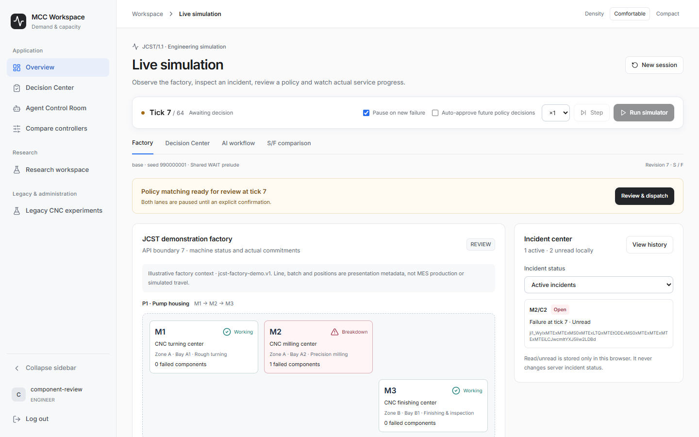
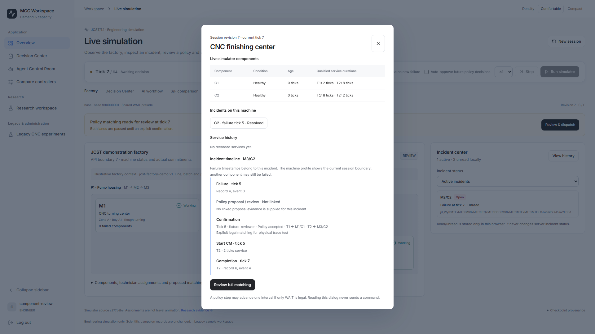

# Factory monitoring — component evidence only

**INTEGRATION_PENDING:** These captures use producer API examples through intercepted HTTP. They do not prove learned-policy execution or real Start→failure→approve→completion acceptance. The actual registry/checkpoints and DEMO-01 catalogue are missing.

Code/capture SHA: `5e32a2f1bf4cd41ffd0be8554ff0c3f95dc43b35`. Base: `761a4520a53b8f0a3e35295d316bc68342bf6d41`. [Provenance, checks and hashes](provenance.json).

| State | 1440×900 | 1920×1080 |
| --- | --- | --- |
| Factory schematic | [PNG](component-only-factory-1440x900.png) | [PNG](component-only-factory-1920x1080.png) |
| Machine profile | [PNG](component-only-machine-profile-1440x900.png) | [PNG](component-only-machine-profile-1920x1080.png) |
| Incident evidence timeline | [PNG](component-only-machine-timeline-1440x900.png) | [PNG](component-only-machine-timeline-1920x1080.png) |
| Full decision matching | [PNG](component-only-decision-1440x900.png) | [PNG](component-only-decision-1920x1080.png) |
| Service unavailable | [PNG](component-only-error-1440x900.png) | [PNG](component-only-error-1920x1080.png) |
| Missing context list | [PNG](component-only-missing-context-1440x900.png) | [PNG](component-only-missing-context-1920x1080.png) |

[Component-only navigation video](component-only-navigation.webm): profile, incident selection, read-only reload and decision navigation. This is **not** the requested real simulator Start→completion video.

