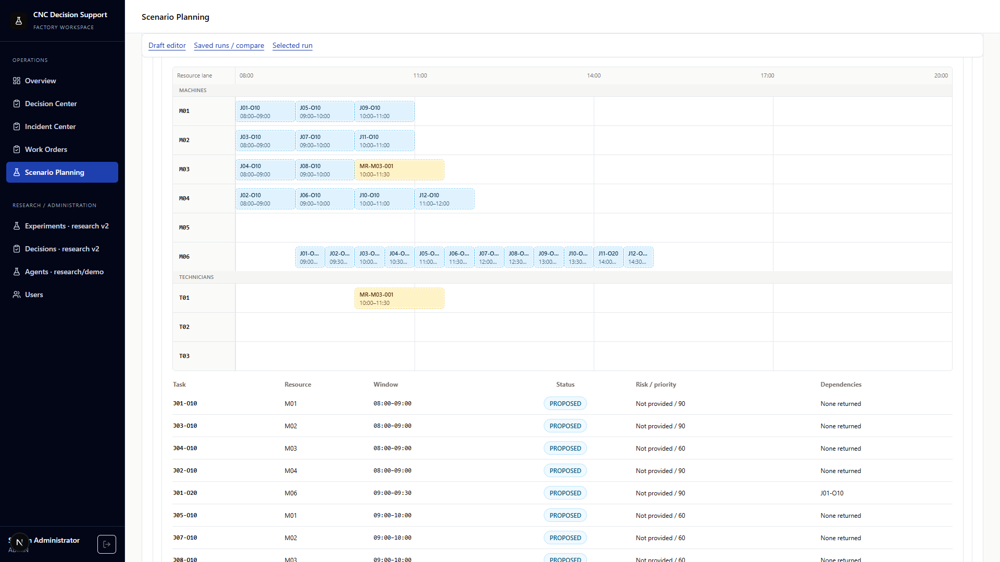
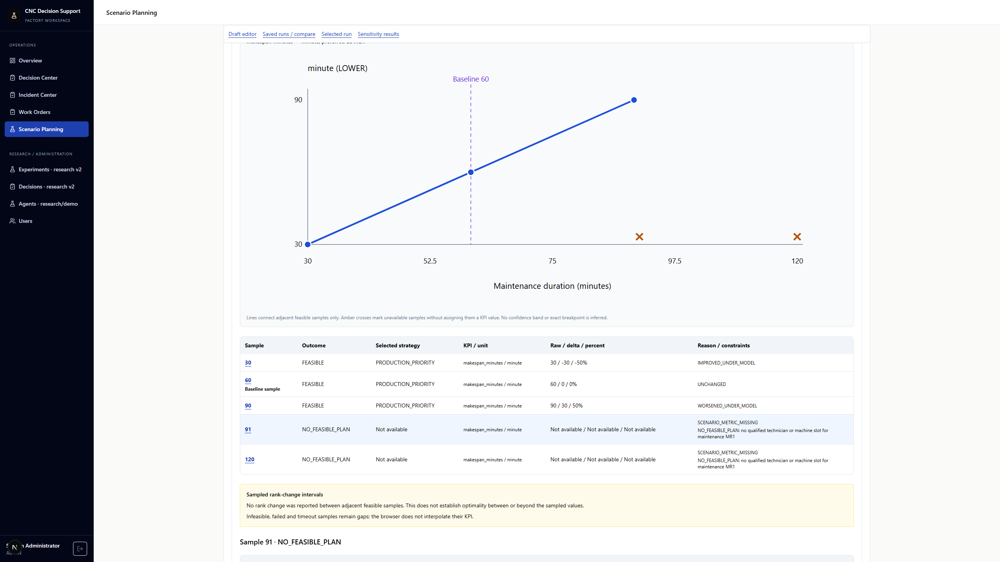
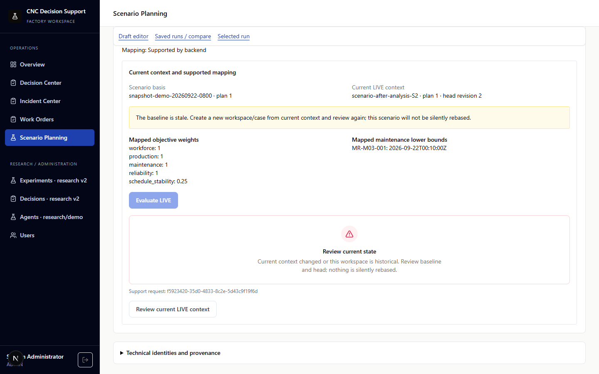

# Scenario Planning — real API acceptance evidence

Capture/code SHA: `8b67bad414322b8bcf44e21e971a7e07ffb88626`.
Producer SHA: `d49ddfbbe3ffddb51cea03077aa032e4acb2ee1e` (#58).
Screenshots are unmodified browser captures from the first of three consecutive
clean-schema runs. The evidence commit only adds documentation/images; its
frontend tree remains identical to the capture SHA. Final CI and its exact head
and merge SHA are recorded in [Draft PR #57](https://github.com/bachng23/reinforcement-learning-cnc/pull/57).

## Recorded checks

- Local contracts:check, typecheck, lint, 375 tests in 42 files and production build passed.
- Three actual Scenario browser runs passed through PostgreSQL, Backend API,
  FastAPI and Scenario/Decision workers, with 17 assertions per run and read-only
  reload. This includes exact lost-response replay, immutable revision replay,
  five physical and five weight samples, comparison, new LIVE planning, stale
  409, cross-factory/VIEWER/revoked access and simulation commit denial.
- An additional combined browser round passed all four Incident, Operations,
  Maintenance and Scenario tests, plus API restart/persistence verification.
- All owned workers/API/browser processes and ports were stopped; all four
  disposable schemas were removed. The private local test PostgreSQL was stopped
  after a zero-leftover-schema check.

The three standalone runs share semantic input hash
`6d5da41f01d2bb31571805181b495f33b2736e423b673370bb0efa4a4aff3c0a`.
These are real service/engine results on test seed data, not frontend fixture
responses. Local runtime used Windows, Node 24.20.0, Python 3.14.7 and PostgreSQL
16.15. Final CI independently checks its Node 22 / Python 3.12 / PostgreSQL 16
environment. Local success does not substitute for the final CI gate.

[Raw SHA-bound run IDs/assertions](screenshots/scenario-planning/real-api/acceptance-summary.json)
and [image hashes, frontend tree and cleanup proof](screenshots/scenario-planning/real-api/provenance.json)
provide provenance without test-user credentials. Full local logs, an offline
HTML review gallery and a ZIP are under
`artifacts/scenario-e2e/8b67bad414322b8bcf44e21e971a7e07ffb88626/`.
Final CI logs and fresh captures are linked from the PR's Actions artifact.

## Actual desktop screenshots

| State | 1440×900 | 1920×1080 | 2560×1440 |
| --- | --- | --- | --- |
| Draft diff review | [PNG](screenshots/scenario-planning/real-api/draft-review-1440x900.png) | [PNG](screenshots/scenario-planning/real-api/draft-review-1920x1080.png) | [PNG](screenshots/scenario-planning/real-api/draft-review-2560x1440.png) |
| Candidate Gantt | [PNG](screenshots/scenario-planning/real-api/computed-candidate-gantt-1440x900.png) | [PNG](screenshots/scenario-planning/real-api/computed-candidate-gantt-1920x1080.png) | [PNG](screenshots/scenario-planning/real-api/computed-candidate-gantt-2560x1440.png) |
| Comparison | [PNG](screenshots/scenario-planning/real-api/saved-run-comparison-1440x900.png) | [PNG](screenshots/scenario-planning/real-api/saved-run-comparison-1920x1080.png) | [PNG](screenshots/scenario-planning/real-api/saved-run-comparison-2560x1440.png) |
| Sensitivity chart | [PNG](screenshots/scenario-planning/real-api/physical-sensitivity-1440x900.png) | [PNG](screenshots/scenario-planning/real-api/physical-sensitivity-1920x1080.png) | [PNG](screenshots/scenario-planning/real-api/physical-sensitivity-2560x1440.png) |
| Infeasible samples | [PNG](screenshots/scenario-planning/real-api/golden-infeasible-gaps-1440x900.png) | [PNG](screenshots/scenario-planning/real-api/golden-infeasible-gaps-1920x1080.png) | [PNG](screenshots/scenario-planning/real-api/golden-infeasible-gaps-2560x1440.png) |
| LIVE confirmation | [PNG](screenshots/scenario-planning/real-api/live-confirmation-1440x900.png) | [PNG](screenshots/scenario-planning/real-api/live-confirmation-1920x1080.png) | [PNG](screenshots/scenario-planning/real-api/live-confirmation-2560x1440.png) |
| Stale LIVE context | [PNG](screenshots/scenario-planning/real-api/stale-live-context-1440x900.png) | [PNG](screenshots/scenario-planning/real-api/stale-live-context-1920x1080.png) | [PNG](screenshots/scenario-planning/real-api/stale-live-context-2560x1440.png) |

See the [route/API map](frontend-scenario-planning.md) and
[runbook](frontend-scenario-planning-runbook.md) for setup and reproduction.
Legacy `contract-harness` images remain labelled component evidence and are not
used as real API acceptance proof.
